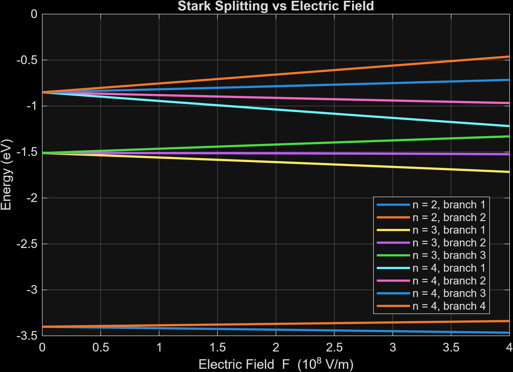

# Hydrogen Stark Effect in MATLAB

Academic project from IF321 Numerical Methods, Physical Engineering, National University of Engineering (UNI), Peru.

How do hydrogen energy levels split when a static electric field is applied? This model constructs a finite Hamiltonian in the hydrogen basis with magnetic quantum number `m = 0`. It evaluates the dipole matrix elements using radial integration and computes energy levels with Jacobi rotations.

*Figure from the original coursework. The model uses a basis truncated at n = 4.*

## Run the example

Open MATLAB, set the current folder to this repository, and enter `run_demo`. The demo checks the field-free energies, compares Jacobi eigenvalues with MATLAB's `eig` across the field sweep, and exports `stark-splitting.png` to the repository root. It uses MATLAB functions without extra toolboxes. Local MATLAB execution is pending because the installed copy returned a licensing error.

## Independent reference results

A separate calculation reconstructed the radial integrals analytically and compared the Jacobi rotations with a symmetric eigensolver. At `F = 0`, the levels matched `-1/(2*n^2)` Hartree. For `F = 2e8 V/m` and `nmax = 4`, the energy span of the two levels associated with `n = 2` was approximately **0.06351 eV**.

The solver comparison measures agreement on a finite matrix. Increasing the basis from `nmax = 4` to `6` changed some of the first ten sorted energies by up to about 0.15 eV at `2e8 V/m`. The plot illustrates a truncated model in the `m = 0` sector.
