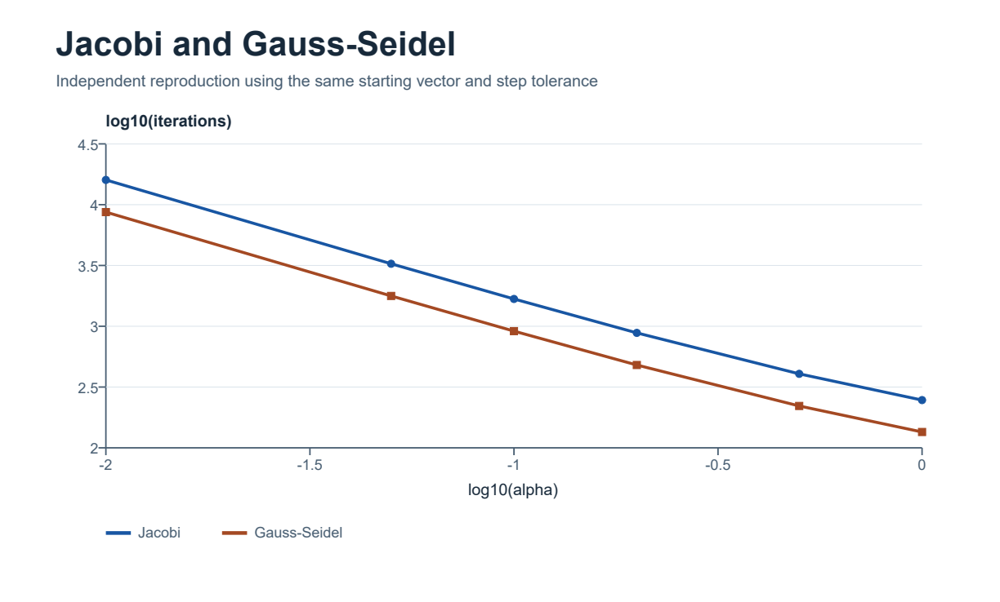

# Jacobi and Gauss–Seidel in MATLAB

Academic project from IF321 Numerical Methods, Physical Engineering, National University of Engineering (UNI), Peru.

Compare two stationary iterative solvers on the same eight-variable system as the parameter `alpha` changes. The demo reports the spectral radius of each iteration matrix, the number of steps, the final residual `norm(A*x-b)`, and the error against MATLAB's direct solution `A\b`.

*Figure from the independent calculation.*

## Run the example

Open MATLAB, set the current folder to this repository, and enter `run_demo`. It prints a table for all six coursework cases and exports `solver-convergence.png`. It uses MATLAB functions without extra toolboxes. Local MATLAB execution is pending because the installed copy returned a licensing error.

## Independent reference results

Both solvers started at the same vector and stopped when the 2-norm of the step was at most `5e-5`.

| alpha | Jacobi radius | Jacobi iterations | Gauss–Seidel radius | Gauss–Seidel iterations |
| ---: | ---: | ---: | ---: | ---: |
| 1 | 0.968311 | 247 | 0.937651 | 135 |
| 0.01 | 0.999503 | 15,982 | 0.999006 | 8,689 |

Gauss–Seidel needed fewer iterations on all six cases in the independent reproduction. When `alpha = 0.01`, the error against the direct solution was about 0.1005 for Jacobi and 0.0502 for Gauss–Seidel in the 2-norm, even though the step criterion was satisfied. This illustrates why the demo also reports the residual and solution error.
