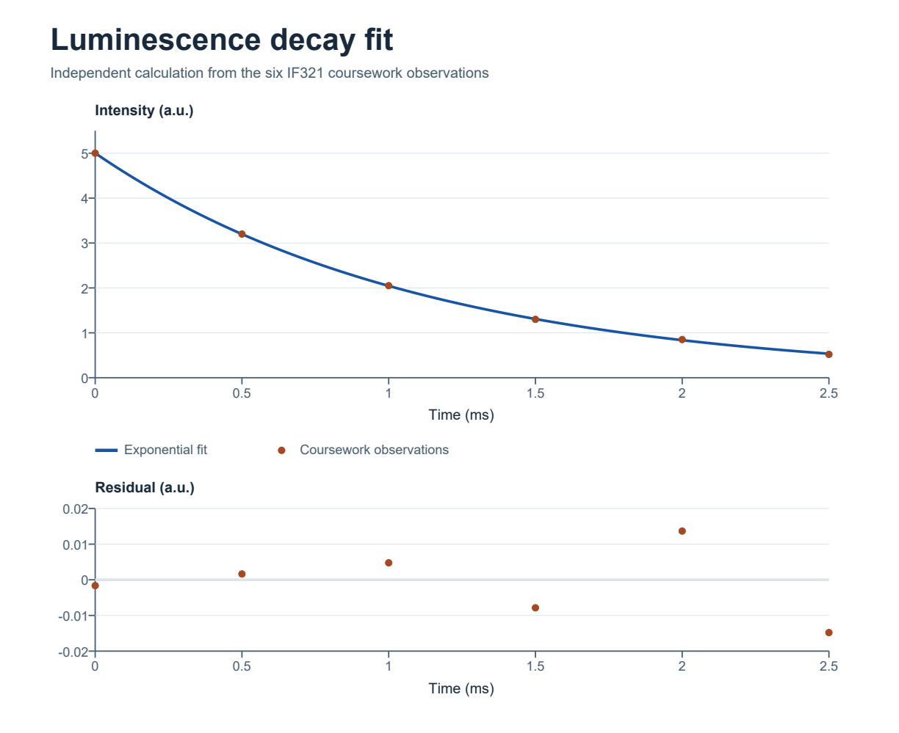

# Luminescence Decay Fit in MATLAB

Academic project from IF321 Numerical Methods, Physical Engineering, National University of Engineering (UNI), Peru.

Estimate the amplitude and decay rate in the model `I(t) = A exp(-k t)` from six coursework observations. The example uses Gauss–Newton with an analytical Jacobian and shows the fitted curve, residuals, and an approximate pointwise 95% prediction interval. The observations are embedded in the demo. Time is given in milliseconds in the coursework.

*Figure from the independent calculation.*

## Run the example

Open MATLAB, set the current folder to this repository, and enter `run_demo`. The demo prints the fitted parameters, checks them against reference values, and exports `luminescence-fit.png`. It uses MATLAB functions without extra toolboxes. Local MATLAB execution is pending because the installed copy returned a licensing error.

## Independent reference results

The coursework iterations reached the stopping criterion after four steps in an independent reproduction. A second calculation solved for the best amplitude at each trial decay rate and searched for the minimum over the decay rate.

| Quantity | Reference |
| --- | ---: |
| Amplitude A (a.u.) | 5.00164 |
| Decay rate k (1/ms) | 0.89425 |
| Residual sum of squares | 0.00049576 |
| In-sample RMSE (a.u.) | 0.00909 |

The prediction interval uses a linearization at the fitted parameters and assumes independent errors with constant variance and approximate normality. The six coursework observations do not establish performance on new data.
